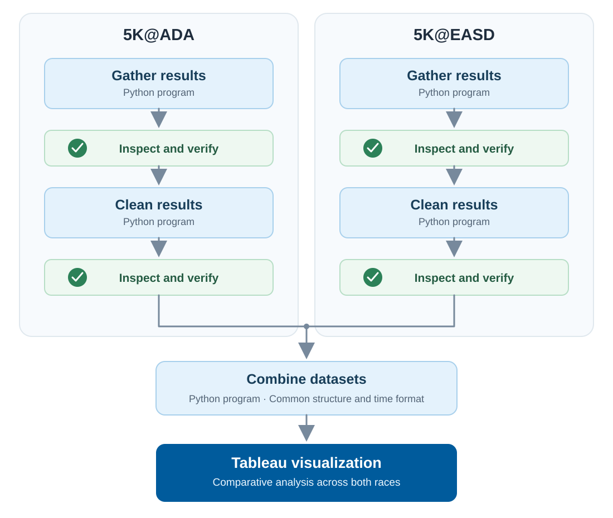

# 5K@ADA and 5K@EASD Race Results: Data Processing and Visualization

Python and Jupyter Notebook programs for gathering, cleaning, validating, and combining results from the **2026 5K@ADA and 5K@EASD virtual races**. The combined results support interactive analysis in Tableau.

## Project Overview

This project revisits earlier race-results analyses with improvements to data retrieval, data quality checks, and maintainability.

The original data-gathering programs relied on Selenium and HTML parsing. The updated approach retrieves structured JSON data directly and checks the completeness and consistency of retrieved records. The 2026 results for both races have matching columns, making it easier to prepare a shared dataset for comparison.

Rather than running one large program, the workflow keeps **data gathering, cleaning, and combining in separate notebooks**, with opportunities to inspect intermediate outputs and troubleshoot individual stages.

## Data Processing Workflow



*Each race is gathered and cleaned independently. Review checkpoints precede the combination of results into a Tableau-ready dataset.*

1. **Gather:** Retrieve results, validate the responses, and export the downloaded dataset.
2. **Inspect:** Check the retrieved data before cleaning it.
3. **Clean:** Check duplicates, handle missing values, and standardize fields.
4. **Inspect again:** Confirm the cleaned output before combining datasets.
5. **Combine:** Merge the two race datasets and prepare finishing times for Tableau.
6. **Visualize:** Analyze the combined results in Tableau.

## Repository Structure

```text
.
├── 5K@ADA/
│   ├── ADA Race Results.ipynb
│   └── Clean ADA Race Results.ipynb
├── 5K@EASD/
│   ├── EASD Race Results.ipynb
│   └── Clean EASD Race Results.ipynb
├── Combine Data/
│   └── Combine Race Results.ipynb
├── images/
│   └── race_results_pipeline.svg
├── README.md
└── LICENSE
```

### 5K@ADA

- **`ADA Race Results.ipynb`** retrieves the 5K@ADA results for inspection and export.
- **`Clean ADA Race Results.ipynb`** cleans and standardizes the downloaded results.

### 5K@EASD

- **`EASD Race Results.ipynb`** retrieves 5K@EASD results using structured data requests and validates the retrieved records.
- **`Clean EASD Race Results.ipynb`** checks duplicates, handles missing values, and standardizes fields.

### Combine Data

- **`Combine Race Results.ipynb`** loads the cleaned files, combines the results, converts finishing times to a Tableau-compatible numeric format, and exports an Excel workbook.

## Running the Notebooks

These programs are designed for Python and Jupyter Notebook. Data processing uses **pandas**; the updated data-gathering approach uses Python's standard library for JSON requests.

1. Open and run the appropriate race gathering notebook.
2. Inspect the downloaded data and confirm that the results look complete.
3. Open and run its cleaning notebook.
4. Review the cleaned dataset and confirm the expected fields and records.
5. Repeat these steps for the other race.
6. Run **`Combine Data/Combine Race Results.ipynb`** after both cleaned datasets are available.
7. Review the combined output and use the exported Excel workbook as the Tableau data source.

**Before running:** Review file paths, input filenames, output locations, and any race-specific source settings in each notebook. Adjust these for your environment. The external race-results service may change over time.

## Data Structure

The cleaned datasets use the same six fields:

| Field | Description |
| --- | --- |
| Race | Race identifier |
| Year | Race year |
| Country Code | Participant country code |
| Age Group | Standardized age-group label |
| Time | Recorded finishing time |
| Gender | Standardized gender label |

The combining notebook converts finishing times to numeric fractions of a day for the Excel output used in Tableau.

## Data Quality and Validation

The updated workflow includes checks for:

- Expected record counts and pagination consistency during retrieval.
- Repeated pages and duplicate identifiers, when supplied.
- Duplicate records during cleaning.
- Missing-value handling that preserves valid country codes, including `NA` for Namibia.
- Consistent gender and age-group labels.
- Intermediate data structure and missing values before combination.

Validation reduces the risk of incomplete or inconsistent results, but review is still appropriate when an external source changes.

## Tableau Visualizations

The combined 2026 results support interactive views of participation by country, top participating countries, age groups, and finishing-time distributions and measures.

[**Explore the 2026 5K@ADA and 5K@EASD Results on Tableau Public**](https://public.tableau.com/views/5KADAEASDResults/20265KADAand5KEASDRaceResults)

## Related Article

**Improving the 5K@ADA and 5K@EASD Data Pipeline: Automation, Validation, and Visualization**

The companion article explains the evolution of the projects, improvements to data gathering and cleaning, and the rationale for retaining separate processing stages.

[**Read the Article at JCS Analytics**]([https://public.tableau.com/views/5KADAEASDResults/20265KADAand5KEASDRaceResults](https://jcsanalytics.com/index.php/articles/automation-and-workflows/improving-the-5k-ada-and-5k-easd-data-pipeline-automation-validation-and-visualization))

## Scope and Notes

This repository focuses on the **2026** results from both races. Earlier analyses explored historical trends, but changing columns across years made historical comparisons more difficult.

The programs depend on third-party race-result services. Changes to their fields, response formats, or availability may require code updates.

## License

Source code in this repository is licensed under the **MIT License**. See [LICENSE](LICENSE) for details.
